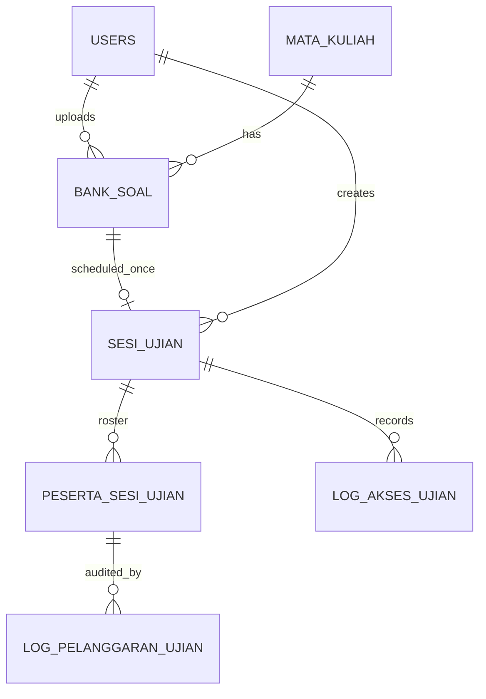

# Analisis Database SIKASA

Analisis berdasarkan model dan migrasi yang ada di workspace. Cocokkan schema database target dengan `php artisan migrate:status` sebelum deployment.

## Entitas yang digunakan

| Tabel | Fungsi | Relasi/catatan |
|---|---|---|
| `users` | Akun staf: NIDN, nama, email, password, role, status aktif | Role internal dosen/kaprodi/panitia/admin_it; bukan akun mahasiswa. |
| `mata_kuliah` | Mata kuliah, kelas, semester, tahun akademik | Dipakai relasi bank soal. |
| `dosen_mata_kuliah` | Penugasan pengampu | Relasi staf dosen dengan mata kuliah. |
| `bank_soal` | Metadata soal dan path file terenkripsi | Memiliki pemilik, mata kuliah, approval dan sesi. Path privat. |
| `revisi_soal` | Revisi serta keputusan soal | Terhubung ke soal dan dosen. |
| `sesi_ujian` | Metadata, jadwal, status, dan kredensial QR | `bank_soal_id` unik dalam schema sekarang; token plaintext lama dimigrasikan ke `token_hash` + `token_encrypted`. |
| `peserta_sesi_ujian` | NIM/nama/email peserta roster | Unik per sesi+NIM; email terenkripsi, OTP hash/expiry/attempts, hash kredensial dan waktu verifikasi. |
| `log_akses_ujian` | Waktu akses dan identitas roster | Relasi sesi; mencatat hit akses, status, dan IP terakhir. Hindari data sensitif tambahan. |
| `log_pelanggaran_ujian` | Riwayat perpindahan halaman, permintaan Panitia, dan keputusan Admin IT | Terhubung ke peserta dan sesi; mencatat jenis kejadian, nomor pelanggaran, catatan tindakan, waktu, dan IP. Counter/lock serta metadata permintaan tersimpan pada peserta sesi. |
| `log_aktivitas` | Audit aktivitas staf dan perubahan sesi | Jangan masukkan token, OTP, email, atau path privat. |
| `log_cetak`, `printer` | Jejak dan inventaris modul lama | Tidak dihapus dalam revisi distribusi QR. |
| `template_soal`, `notifikasi`, `pengaturan_sistem`, `backup_logs` | Fitur aplikasi lain | Tetap terpisah dari data distribusi ujian. |

## Relasi utama

## Catatan migrasi dan batasan

- Migrasi `2026_11_15_000001` membuat sesi/log akses. `000002` memperkuat token, menambah metadata/lifecycle, dan menghapus kolom token raw setelah backfill hash serta ciphertext. `000003` membuat roster peserta; `000004` memperluas kolom email terenkripsi.
- Email peserta memakai Laravel encrypted cast; ubah `APP_KEY` tanpa strategi re-enkripsi akan membuat email lama tidak terbaca. Token QR terenkripsi juga bergantung pada key yang sama.
- Migration `2026_11_15_000005` menambah counter pelanggaran, status terkunci, permintaan Panitia, dan proses buka oleh Admin IT serta tabel audit kejadian. Admin membuka akses dengan menghapus lock dan mereset counter, tetapi meminta mahasiswa melakukan OTP ulang.
- Kode sesi menggunakan status lifecycle `draft`, `scheduled`, `active`, `suspended`, `completed`, dan `cancelled`. Waktu akhir tetap menjadi batas akses otoritatif walaupun status persisten belum diperbarui scheduler.
- `bank_soal_id` masih unik di `sesi_ujian`; penggunaan satu PDF untuk beberapa kelas/sesi perlu migrasi yang menghapus constraint tersebut dan tinjauan aturan bisnis.
- Sistem belum memiliki tabel akun mahasiswa atau sumber roster kampus. Roster diimpor per sesi dan email harus diverifikasi oleh Panitia dari sumber resmi.
- Tabel/kolom QR dan jadwal legacy pada `bank_soal`, serta modul cetak lama, tidak dibuang agar data historis dan fungsi lain tetap aman.

## Kebijakan deployment

Jangan mengedit migrasi yang sudah berjalan di lingkungan bersama. Ambil backup DB, cek status migrasi dan struktur aktual, lalu jalankan forward migrations pada target yang benar. Migrasi lokal pada workspace telah diterapkan; itu tidak berarti database produksi sudah berubah.
