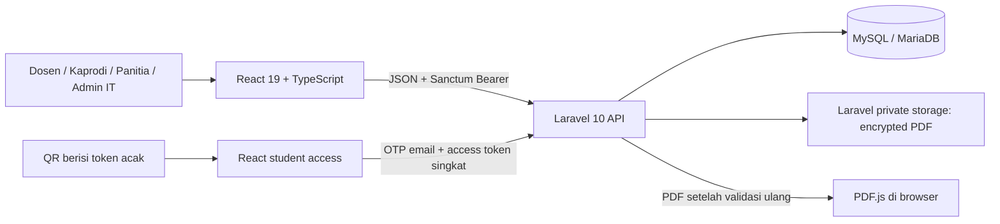

# Arsitektur SIKASA

## Batas runtime

Frontend dan backend disajikan terpisah. Aplikasi staf menggunakan React SPA. Halaman QR berjalan pada hash route `#/akses/{token}` di frontend yang sama. `SIKASA_FRONTEND_URL` membentuk link QR; `API_BASE` di `src/db.ts` menunjuk API Laravel.

## Frontend

- `src/App.tsx`: halaman internal, navigasi role, manajemen sesi, QR, daftar peserta, dan log.
- `src/StudentAccess.tsx` + `src/student-access.css`: halaman mobile mahasiswa, OTP, timer, watermark, kontrol halaman/zoom/fullscreen PDF.js.
- `src/db.ts`: tipe dan pemetaan data, API internal, API sesi, roster, token, dan log.
- `src/main.tsx`, `src/index.css`: bootstrap React dan style umum.

## Backend

- `backend/routes/api.php`: route staff Sanctum/role dan route publik terbatas untuk QR, OTP, verifikasi, dan PDF.
- `BankSoalController`: upload PDF, pengelolaan dosen, preview/persetujuan Kaprodi.
- `SesiUjianController`: CRUD sesi, transisi status, rotasi/revoke token, perpanjangan, QR, dan log.
- `PesertaSesiUjianController`: impor CSV roster dan penghapusan roster sebelum sesi digunakan.
- `UjianOnlineController`: metadata QR, pengiriman/verifikasi OTP, otorisasi PDF, dekripsi dan pencatatan akses.
- `AksesDiblokirController`: daftar mahasiswa terkunci, permintaan pembukaan dari Panitia, dan keputusan Admin IT.
- `FileProtectionService`: enkripsi/dekripsi file melalui Laravel Crypt.
- `QrTokenService`: token acak, hash lookup, salinan terenkripsi, expiry, revocation.
- `PesertaSesiUjian`: email terenkripsi dengan cast Eloquent, OTP hash dan kredensial akses terverifikasi berbentuk hash.
- `SecurityHeaders`: header keamanan HTTP; `config/cors.php` membatasi origin melalui konfigurasi.
- `app/Console/Kernel.php`: scheduler menutup sesi yang berakhir.

## Autentikasi dan otorisasi

Pengguna internal memakai Sanctum dan middleware role (`dosen`, `kaprodi`, `panitia`, `admin_it`). Endpoint mahasiswa tidak memakai akun internal. QR token membuka sesi, lalu NIM dicocokkan dengan roster per sesi dan OTP dikirim ke email yang diimpor untuk peserta tersebut. Roster harus berasal dari sumber institusi tepercaya. OTP membuktikan akses email, bukan SSO/identitas formal kampus.

## Jalur data soal

1. Upload PDF divalidasi oleh API; `FileProtectionService` mengenkripsi isi sebelum menulis ke disk `local` privat.
2. Database menyimpan metadata dan path privat. Path tidak dikembalikan ke halaman publik.
3. Persetujuan Kaprodi diwajibkan sebelum sesi dibuat/diaktifkan.
4. Sesi memiliki hash token, salinan token terenkripsi untuk QR Panitia, expiry, dan waktu revoke.
5. OTP dan kredensial akses mahasiswa disimpan dalam bentuk hash; kredensial akses singkat dikirim hanya setelah verifikasi OTP.
6. Setiap permintaan PDF memvalidasi token QR, kredensial peserta, waktu/status sesi, dan status persetujuan. File didekripsi di backend lalu dikirim dengan `no-store`; viewer merender blob di browser.
7. Sinyal halaman tersembunyi menambah pelanggaran; tiga laporan mengunci peserta dan mencabut kredensial. Panitia mencatat konfirmasi dan meminta Admin IT membuka akses. Setelah dibuka, mahasiswa harus melewati OTP lagi.

Viewer menggunakan satu blob terbatas sesuai batas upload (10 MB), tidak mengimplementasikan HTTP Range. Browser perlu menerima isi PDF agar dapat merender halaman. Tidak ada file plaintext yang ditempatkan pada public storage.

## Operasional

Konfigurasikan `SIKASA_FRONTEND_URL` dan CORS dengan alamat frontend yang dapat dijangkau HP, `API_BASE` dengan alamat backend, SMTP Laravel untuk OTP, HTTPS untuk ujian, serta scheduler Laravel tiap menit. Pemeriksaan waktu di endpoint tetap menutup akses meski scheduler terlambat; scheduler memperbarui status sesi di database.
